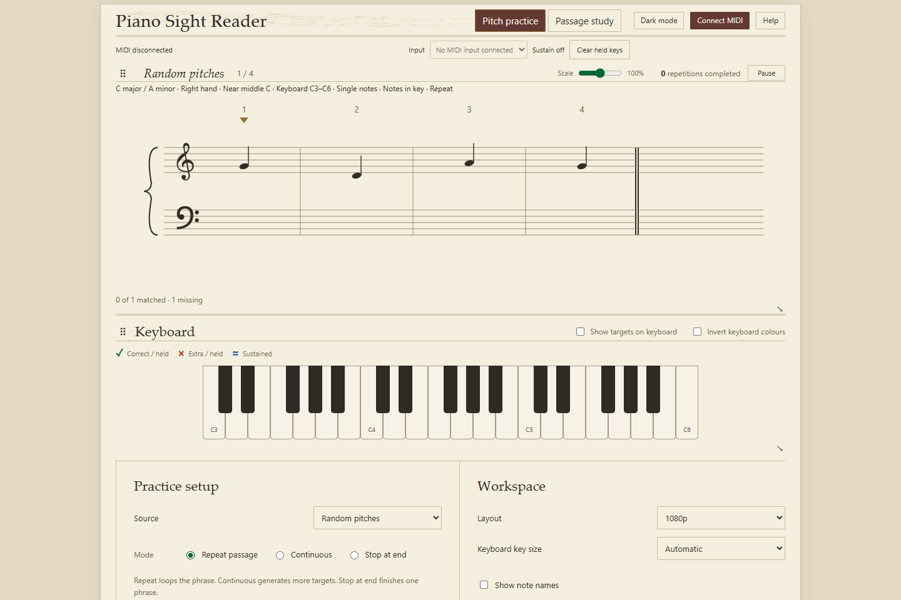
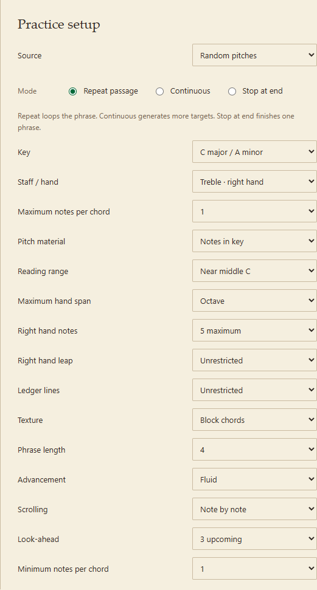
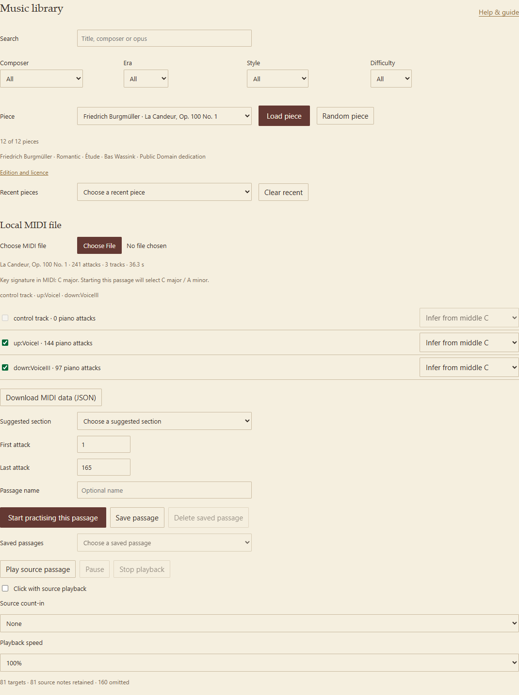
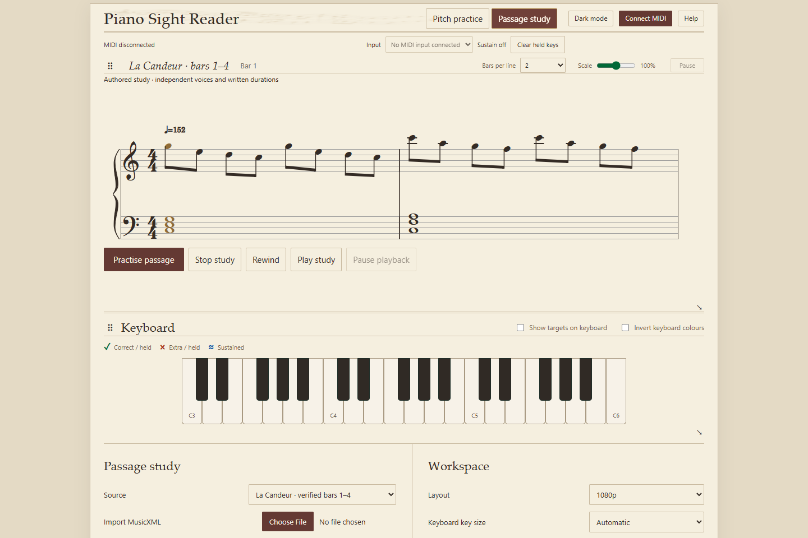
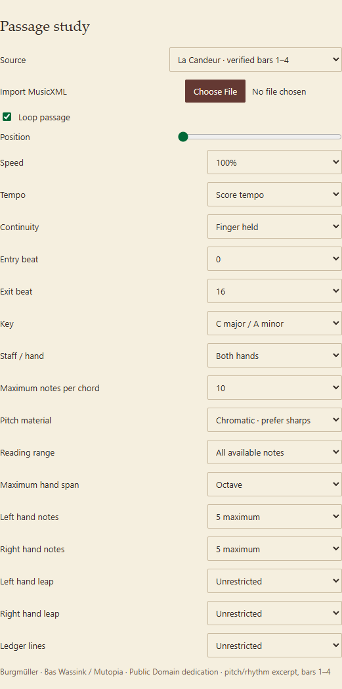
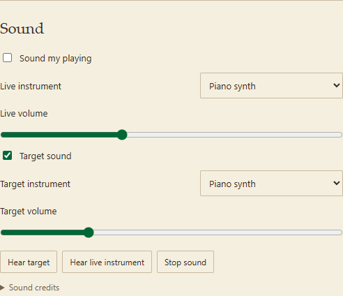
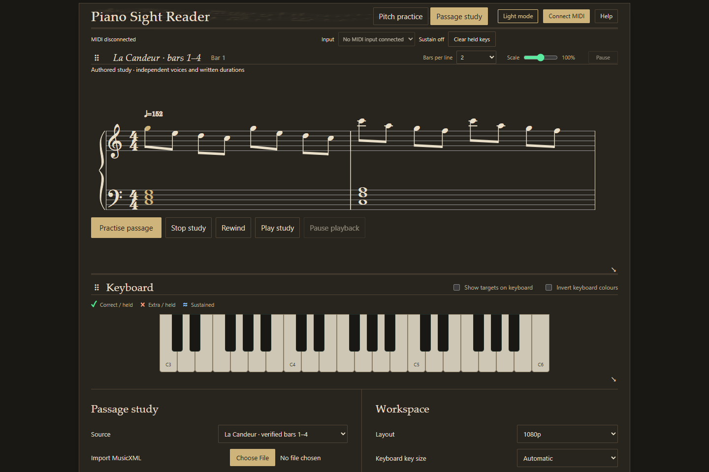

# A pianist’s guide to Piano Sight Reader

This guide is for your first visit. You can already play the piano; the aim here
is to become quicker and more comfortable at turning written notes into movement.
Start with material that feels almost too easy, then increase one difficulty at
a time.

There are two ways to work:

- **Pitch practice** waits while you find each note or chord. Use it for fluent
  note recognition, chord shapes and unfamiliar keys.
- **Passage study** shows rhythmic notation and lets you work on written holds,
  rests and ties. It waits for corrections rather than leaving you behind.

You can use generated exercises, the included music, or your own supported files.
You do not need to read all the settings before playing.

*The screenshots show the actual app in Edge. No physical MIDI instrument was
connected for these pictures. Your generated notes will be different.*

## Get to the piano

On Windows, open the project folder and double-click **start.cmd**. Leave the
window it opens running. Your browser should open the practice page. The first
start may take longer while the app sets itself up. You need Python installed;
the [main README](../README.md#install-and-run) has setup instructions, including
macOS and Linux.

Use **Chrome or Edge** if you want the app to follow a USB MIDI piano. If another
browser opens automatically, copy the address into Chrome or Edge. Normally it
is `http://127.0.0.1:8767`—an address on your own computer.

1. Connect your piano to the computer using its MIDI connection.
2. Click **Connect MIDI** near the top and allow the browser to access it.
3. Choose your piano in **Input** if more than one device appears.
4. Play a note. Check that the on-screen key lights up and the last-note
   indicator changes.
5. Scroll to **Physical keyboard range**. Click **Learn lowest key** and play your
   lowest key; then use **Learn highest key** for the other end.

These endpoints tell the app what you can reach on your instrument. **Reading
range**, which you will use shortly, is a separate choice about how much of that
keyboard you want to practise today. Middle C is called **C4 / MIDI 60** here;
your piano may give the same key a different octave name.

If you do not have a connected piano, try the on-screen keys. A mouse is suitable
for single notes; a touch screen can play several keys together. This is useful
for exploring the app, although a MIDI piano is much better for chord practice.
The app follows key presses, not microphone sound from an acoustic piano.

## Your first five minutes

Choose **Pitch practice** at the top. In **Practice setup**, use:

| Setting | First-session choice |
| --- | --- |
| Source | Random pitches |
| Mode | Repeat passage |
| Staff / hand | Treble · right hand |
| Key | C major / A minor |
| Minimum notes per chord | 1 |
| Maximum notes per chord | 1 |
| Pitch material | Notes in key |
| Reading range | Near middle C |
| Phrase length | 4 |
| Advancement | Fluid |

Practice is ready immediately. Read the current note beside the clefs and play
it. The next target moves into place when you have the right pitches. There is
no deadline. At the end, the phrase repeats automatically.

Read from the stave first. If you are stuck, **Show note names** is in
**Workspace**, and **Show targets on keyboard** is above the on-screen keys.
Use either briefly, then try the phrase again without it. Target markers are
off initially so you can practise reading rather than copying illuminated keys.

Repeat a phrase until recognition is comfortable. Then choose **Continuous** for
fresh targets so that familiarity with one little sequence does not take over
from reading. Try **Bass · left hand** next. Leave the range small at first.

*Settings appear or disappear according to the source and hand you select. This
picture shows the controls for generated right-hand pitch practice.*

## What the feedback is telling you

Play all the pitches in the current target, without extra keys. With a chord,
your fingers do not have to land at precisely the same instant: the app waits
until the required pitches are physically held together.

- **✓** marks a correct note.
- **×** marks an extra held note.
- **≈** and a patterned key mark a released note still sounding under sustain.
- **◆** marks a target when you turn on the keyboard aid.
- **↑ / ↓** suggest moving a wrong pitch higher or lower.

The symbols matter as well as the colours. A missing arrow does not mean a
wrong note is correct: with chords the app only suggests a direction when the
nearby pairing is clear. It cannot tell which finger you used.

In **Fluid** advancement, a correct pitch set advances immediately. Every note
in the next target needs a new press. If C appears in two successive chords,
release C and play it again for the second chord. Simply keeping it down does
not count. Other notes from the preceding target can overlap briefly.

Choose **Release between targets** if you prefer to play a chord, release all
the keys, then read the next one. The sustain pedal affects sound; it cannot
replace the physical keys needed to answer a pitch target.

A chord name may appear after a correct answer. It is one possible name for a
recognised shape, rather than a harmonic analysis of the piece. Some perfectly
valid pitch combinations have no label.

**Pause** stops advancement while letting you explore the keys. **Resume** needs
fresh key presses. **Stop at end** lets you complete one phrase and finish;
**Restart passage** appears afterwards.

## Make reading harder in useful steps

Try changing just one of these at a time:

1. Move from treble to bass, then to both hands.
2. Keep single notes but change to another familiar key signature.
3. Widen **Reading range** to include more ledger notes.
4. Set the minimum and maximum chord sizes to 2, then 3.
5. Try **Chromatic · prefer sharps** or **Chromatic · prefer flats**.
6. Add more look-ahead once you can read the current target confidently.

For chord reading, start with **Diatonic chords**, **Block chords**, and
**Triads**, allowing three notes and a comfortable hand span. **Cadence** puts
the harmonies in familiar sequences. **Advanced harmony** adds secondary
dominants, diminished sevenths, borrowed harmony and other richer spellings.
It is useful when the written accidentals themselves are the challenge.

**Left hand notes** and **Right hand notes** limit the density separately.
**Maximum hand span**, the two leap limits and **Ledger lines** help keep a
session focused. If the constraints are too tight, the app may show fewer notes
or ask you to adjust them. It does not stretch your chosen limits to fill a chord.

**Broken chords** and **Alberti bass** are useful for reading moving patterns.
The generated **Attack pattern** choices also separate the hands in different
orders. These are still untimed pitch exercises: a “three per two” attack group
does not assess a performed polyrhythm. Use Passage study for written durations.

## Work on a piece

Scroll to **Music library**. Search for a composer or title, choose a piece, then
click **Load piece**. **Random piece** loads a choice from the current search and
filters. Difficulty is currently **Unrated**, so judge a short passage yourself.

Loading opens a preview; your existing exercise is still active. The heading
above the stave tells you what you are actually practising.

1. Choose a **Suggested section**, or set a short **First attack / Last attack**
   range—try 1 to 8 as a starting point. An attack is a new note onset or group
   of simultaneous onsets, not a bar number.
2. Check the included tracks. Choose **Treble** or **Bass** explicitly if the
   middle-C inference puts notes on an unhelpful stave.
3. Check the retained/omitted note count. Your hand, reading range, pitch
   material and density limits can simplify the passage considerably.
4. Use **Start practising this passage** to activate the selection explicitly.

Selecting a suggested section, changing the endpoints or tracks, or restoring a
saved passage also activates that selection automatically. Release the keys
before beginning the new material.

Start with one hand and **Repeat passage**. The pitch outline asks for new
attacks; it does not yet ask you to reproduce the piece’s rhythm or long holds.
Once the notes feel familiar, choose **Passage study** to work with derived
durations and ties. A MIDI file describes a performance; its derived notation
may look different from your printed edition.

**Play source passage** lets you listen to the selected MIDI passage using its
source timing and pedal. Slow it with **Playback speed**. For a count-in, turn on
**Click with source playback** and choose **Source count-in**. Listening does
not answer practice targets for you.

Give a useful passage a name, such as “opening, left hand”, and choose **Save
passage**. On another visit, load the same piece or the same local file, then
choose it from **Saved passages**. This saves the selection and track choices;
it does not save a private music file or all your practice settings.

For a longer pitch-reading session, **Continue through piece** advances beyond
the selected window to following source attacks. **Stop at end** finishes the
selection once. To return to generated notes, choose **Pitch practice**, then
**Source → Random pitches**.

## Study rhythm, holds and independent voices

Choose **Passage study**. For a first example, select **La Candeur · verified
bars 1–4** in its **Source** menu. Choose **Both hands**, a broad enough range
and sufficient chord/hand limits to retain the bass chords. Use chromatic pitch
material when you want filters to retain altered notes too.

1. Choose **Play study** to hear the written study. This is different from
   **Play source passage**, which hears the MIDI preview below.
2. Stop listening, set **Speed** to 50% if helpful, and choose **Practise passage**.
3. Release keys and pedal when prompted, then play the highlighted notes.
4. Hold continuing notes for their written durations. Release notes when their
   voice rests, while keeping any other voices that must continue.

This is patient practice. The duration clock runs while the required state is
correct. If you release too soon or add a wrong note, it waits for you to correct
the problem. It does not grade how late you arrived at the next attack.

**Continuity → Finger held** asks you to keep continuing notes physically down.
**Pedal supported** also accepts already-attacked notes sustained by the pedal.
Neither setting lets pedal supply a missing new attack.

**Entry beat / Exit beat** make a smaller study cut. These numbers count
quarter-note beats from zero, not bars; the exit excludes new attacks there.
**Loop passage** repeats the cut after you release keys and pedal. If the entry
cuts into a tie, play that note freshly to establish the starting sound.

Use **Pause** above the stave for a practice break. On resuming, release and
reattack the active notes; their current duration starts again. **Stop study**
returns to the entry. **Pause playback** pauses listening; **Rewind** returns to
the entry and continues listening if it was already running.

The other original studies explore independent voices, notation and continuity,
meter groupings, and gradual tempo changes. With the last of these, **Score
tempo** follows the written changes; **Steady tempo** keeps the opening tempo.
Speed adjusts either choice.

## Choose how you hear it

If your digital piano already makes sound, leave **Sound my playing** off. If
you are using a silent MIDI controller, enable it and choose **Live instrument**.
The options are **Piano synth**, **Acoustic grand piano**, and **Organ synth**.

**Hear live instrument** auditions the current notes with that instrument; it
does not enable sound for your playing. **Target sound** has its own instrument
and volume, used by **Hear target**, source listening and study listening.
Listening never counts as your input.

The separate **Metronome** can give you a pulse. Pitch practice still waits for
you. Its tempo does not set study speed or replace the source playback tempo.
Use **Stop sound** to silence the app. Switching away from the page also stops
sound; check the sound switches when returning.

## Make the page comfortable

Start with **Workspace → Layout → Automatic**. If the keyboard is too low on
your screen, try **720p** or **1080p**. Settings remain further down the page.
**Scale** changes notation size, while **Keyboard key size** changes key width.
In Passage study, **Bars per line → 1** gives dense music more room.

You can move the staff or keyboard using its dotted grip and resize it using
the lower-right corner. This selects a remembered **Custom** layout. Choose a
layout preset to get back to a regular arrangement; choose Custom to restore
your saved arrangement. These display changes preserve practice progress.

In Pitch practice, **Note by note** keeps the active target beside the clefs.
**Page by page** keeps a group still until you finish it. **Look-ahead** sets
how many future targets you want, with fewer shown when space is limited.

**Dark mode** and **Invert keyboard colours** are independent. You can have a
dark page with conventional piano keys. The app remembers these choices.

## A useful fifteen-minute routine

This is a suggested routine, not a programme prescribed by the app:

1. **Three minutes:** single-note Continuous practice in one clef and a small range.
2. **Three minutes:** the other clef, or the same range in a less familiar key.
3. **Four minutes:** a short repeated chord or piece passage. Identify the reading
   difficulty, then change one setting to address it.
4. **Four minutes:** study a short passage at a comfortable speed, attending to
   holds, rests and independent voices.
5. **One minute:** review Progress in Pitch practice and decide what to revisit.

Aim for easier recognition and fewer corrections before speed. When a repeated
phrase starts feeling memorised, test the same reading skill with fresh material.

## Keep progress and return tomorrow

**Progress**, below the library in Pitch practice, shows correct targets,
response times and first-attempt accuracy. The median is a useful typical time;
**90% within** shows how slow the slower responses were. Compare similar
exercises rather than an easy single note with an unfamiliar full chord.

Tick **Save history locally** if you want attempts kept across visits. **Export
history** saves a backup file; **Import history** merges a previous export.
Unchecking saving does not delete older saved history. Use **Clear last hour**,
**Clear today** or **Clear all** deliberately when you want to remove records.
Study corrections appear in the study feedback; these Progress charts describe
pitch-reading attempts rather than a rhythm examination.

Keep using the same browser and local address, including the port number, for
your remembered preferences, saved passages and history. Keep private source
files yourself: reload them on a new visit. To close the app, stop sound, close
the page, and press Ctrl+C in the launcher window.

## If something interrupts practice

| What happens | What to try |
| --- | --- |
| No MIDI notes arrive | Use Chrome/Edge, allow MIDI permission, check Input, reconnect the cable and use the connection button again. After connection its label may be Refresh MIDI. |
| A key stays lit | Release physical keys, then choose Clear held keys. Recheck the pedal and reconnect if necessary. |
| A repeated note will not count | Release that actual key and press it again. Pedal sustain and holding it from the last target do not earn a fresh attack. |
| A piece looks empty or much simpler than expected | Check track inclusion, hand, reading range, pitch material, chord/hand limits and retained/omitted counts. |
| No sound | Enable the intended sound path, check its volume and computer output, then click Hear live instrument or Hear target. MIDI matching can work silently. |
| The page is cramped | Try Automatic or 720p Layout, adjust Scale, or use one bar per line in study. |
| Settings seem to have disappeared | Check that you are using the same browser, profile and address/port. Some controls only appear for the source they affect. |

**Help** opens the local help page in another tab. Its **×** closes it so you
can return to the existing practice page.

Your own MIDI files can be opened with **Choose MIDI file**. Passage study also
accepts a limited uncompressed MusicXML format through **Import MusicXML**;
unsupported files report why they cannot be used. The [README](../README.md)
has file requirements and instructions for discovering more music.

For a comprehensive text explanation intended for an audio/video guide generator,
see the [agent’s usage guide](AGENT_USER_GUIDE.md).
